# EyeTrace: la mirada como pincel digital

> Sistema interactivo que convierte el movimiento de los ojos, capturado con una cámara web, en trazos de arte abstracto en tiempo real. Usa procesamiento digital de imágenes y visión computacional.

**Universidad Autónoma de Occidente · Procesamiento Digital de Imágenes · 2026-2**
**Profesor:** Nicolás Llanos Neuta
**Integrantes:** Sofía Aguiar Arana · Valery Pastas Ávila · Valeria Polanco Muñoz

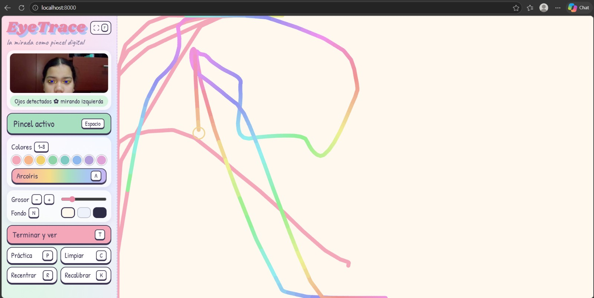

**Contenido**

1. [Descripción del proyecto](#1-descripción-del-proyecto)
2. [Arquitectura del sistema](#2-arquitectura-del-sistema)
3. [Metodología](#3-metodología)
4. [Implementación](#4-implementación)
5. [Datos](#5-datos)
6. [Interfaz gráfica (GUI)](#6-interfaz-gráfica-gui)
7. [Resultados](#7-resultados)
8. [Conclusiones](#8-conclusiones)
9. [Referencias](#9-referencias)

---

## 1. Descripción del proyecto

### Problemática

Las formas tradicionales de crear arte digital dependen del mouse, el teclado o las pantallas táctiles, y eso limita la exploración de nuevas formas de interacción entre una persona y una obra digital. Hacen falta experiencias en las que las acciones del usuario se conviertan directamente en elementos de creación artística.

La mirada puede usarse como una forma alternativa de interacción, transformando los movimientos de los ojos en elementos visuales. Para lograrlo hay que procesar las imágenes de una cámara: identificar las características de los ojos y obtener información sobre la dirección de la mirada.

### Solución propuesta

**EyeTrace** captura el rostro con una cámara web común y procesa cada fotograma con OpenCV y MediaPipe Face Landmarker para localizar el iris y los contornos de los ojos. Con eso estima, mediante una calibración por mínimos cuadrados, el punto del lienzo que la persona está mirando. Ese punto se convierte en un pincel: cada recorrido de la mirada deja un trazo, y cada persona crea una obra abstracta única a partir de su propia forma de mirar.

Además del dibujo libre, el sistema incluye un **modo práctica**, en el que se sigue con los ojos un punto que recorre una figura (mariposa, flor o corazón), y un **modo evaluación**, que mide de forma cuantitativa el desempeño del sistema con participantes reales.

### Justificación

El proyecto se enmarca en el tema del curso, *análisis de la expresión humana en el arte y la cultura*. La mirada es una de las formas más naturales y personales de expresión: hacia dónde miramos, cuánto tiempo y en qué orden revela atención, intención y emoción. EyeTrace convierte ese gesto, normalmente involuntario e invisible, en una huella visible y permanente. Así abre una forma de creación que:

- **no requiere habilidades motoras finas** ni dispositivos especiales, solo una cámara web, por lo que es accesible a más personas;
- **explora la relación entre tecnología, percepción y arte**, en la línea de propuestas interactivas como las de teamLab o EyeDraw (Hornof y Cavender, 2005);
- **aplica de forma integrada** las técnicas del curso: captura y transformación de imágenes, detección de características con un modelo de visión, filtrado temporal y estimación geométrica.

### Objetivos

**General:** desarrollar un sistema interactivo que transforme la dirección y los gestos de la mirada del usuario en trazos de arte abstracto mediante técnicas de procesamiento digital de imágenes y visión computacional.

**Específicos:**

1. Analizar las técnicas de procesamiento digital de imágenes y visión computacional aplicables a la detección de características oculares y a la estimación de la dirección de la mirada con una cámara web.
2. Diseñar la arquitectura y el sistema de interacción de EyeTrace, definiendo el flujo de procesamiento de las imágenes y las reglas que relacionan los movimientos oculares con la generación de arte abstracto.
3. Implementar un prototipo interactivo que detecte características oculares en tiempo real y transforme la mirada en líneas, colores y formas dentro de un lienzo digital.
4. Validar el funcionamiento del prototipo con pruebas con usuarios, evaluando la capacidad del sistema para detectar las interacciones oculares y generar de manera coherente los elementos visuales de la obra.

---

## 2. Arquitectura del sistema

EyeTrace tiene dos partes que se comunican por HTTP en el mismo computador:

- **Motor de visión en Python:** hace todo el procesamiento de imágenes. Captura la cámara con OpenCV, detecta landmarks con MediaPipe, estima la mirada, calibra con NumPy y registra los datos de evaluación.
- **Interfaz web:** muestra el lienzo, la barra de herramientas, la calibración, la práctica y la evaluación. Solo dibuja; no procesa imágenes.

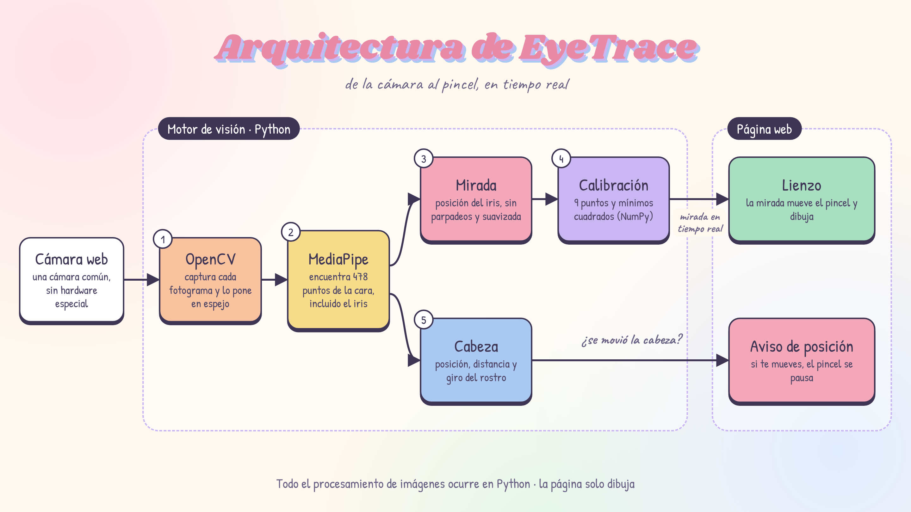

Diagrama técnico detallado, con los canales de comunicación entre Python y la página:

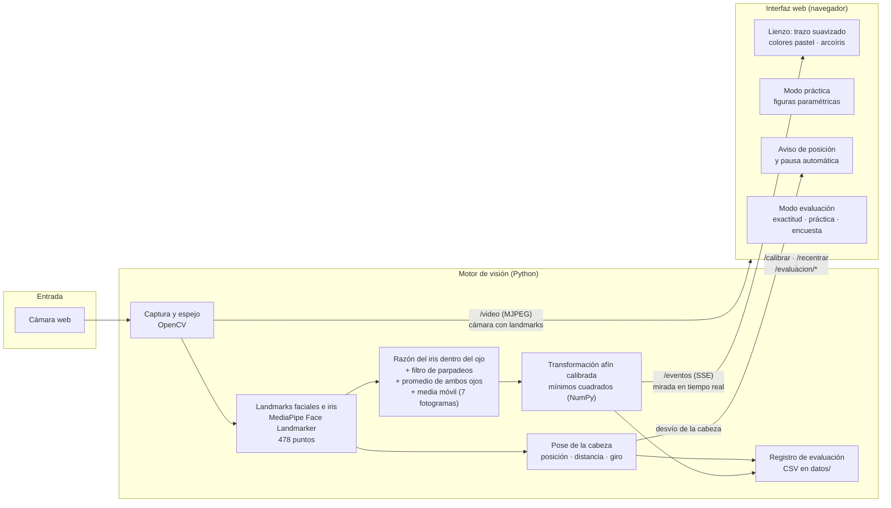

### Módulos

| Módulo | Responsabilidad |
|---|---|
| [`main.py`](main.py) | Servidor web y hilo de la cámara. Une todo el procesamiento y lo expone a la página por `/video`, `/eventos`, `/calibrar`, `/recentrar`, `/guardar` y `/evaluacion/*`. |
| [`eye_tracking.py`](eye_tracking.py) | Detección de landmarks con MediaPipe, cálculo de la posición relativa del iris, filtro de parpadeos, suavizado y pose de la cabeza. |
| [`calibration.py`](calibration.py) | Calibración de 9 puntos (medianas y mínimos cuadrados), transformación mirada → lienzo, referencia de la cabeza y recentrado. |
| [`gaze_detection.py`](gaze_detection.py) | Clasificación de la dirección de la mirada (izquierda, derecha, arriba, abajo, centro). |
| [`evaluacion.py`](evaluacion.py) | Métricas de exactitud y dispersión, y registro de cada sesión de evaluación en CSV. |
| [`analisis/analizar_resultados.py`](analisis/analizar_resultados.py) | Lee `datos/` y genera las tablas y gráficas de `resultados/`. |
| [`web/`](web/) | Interfaz: `index.html`, `estilos.css`, `app.js` y las fuentes tipográficas. |
| [`rutas.py`](rutas.py) | Ubica los archivos tanto en modo script como en el ejecutable `.exe`. |
| [`main_escritorio.py`](main_escritorio.py), [`art_canvas.py`](art_canvas.py) | Primer prototipo de escritorio con Pygame, conservado como versión anterior. |

---

## 3. Metodología

### Fases del proyecto

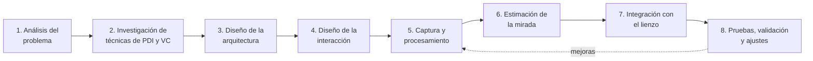

1. **Análisis del problema:** necesidad de nuevas formas de interacción para la creación de arte digital.
2. **Investigación:** estado del arte en seguimiento ocular con cámara web (Hansen y Ji, 2010; Zhang et al., 2015; Papoutsaki et al., 2016) y selección de herramientas.
3. **Arquitectura:** separación entre el motor de visión y la interfaz.
4. **Interacción:** la mirada controla un pincel continuo, no zonas discretas. Así hay más libertad expresiva que con categorías fijas como izquierda o derecha.
5. **Captura y procesamiento:** pipeline de OpenCV y MediaPipe.
6. **Estimación de la mirada:** posición relativa del iris, calibración y compensación del movimiento de la cabeza.
7. **Integración:** lienzo web, práctica y vista previa de la obra.
8. **Validación:** modo evaluación con participantes y análisis cuantitativo.

### Técnicas de procesamiento

**a) Captura y preparación del fotograma.** OpenCV (`VideoCapture`) entrega cada fotograma en BGR. Se refleja horizontalmente (`cv2.flip`) para que la interacción funcione como un espejo y se convierte a RGB para MediaPipe.

**b) Detección de landmarks faciales e iris.** MediaPipe Face Landmarker, un modelo de visión basado en redes neuronales (Kartynnik et al., 2019; Ablavatski et al., 2020), estima 478 puntos 3D del rostro en modo video. Para cada ojo se usan las dos esquinas (33 y 133 en un ojo, 362 y 263 en el otro), los párpados superior e inferior (159/145 y 386/374) y los 5 puntos del iris (468–472 y 473–477). El centro del iris $I$ es el promedio de sus 5 puntos.

**c) Posición relativa del iris.** Con $E_1$ y $E_2$ como las esquinas del ojo y $\vec{e} = E_2 - E_1$ como el eje del ojo, se calcula:

$$r_x = \frac{(I - E_1)\cdot\vec{e}}{\lVert\vec{e}\rVert^2}, \qquad r_y = \frac{I_y - y_{eje}(I_x)}{\lVert\vec{e}\rVert}$$

$r_x$ es la proyección del iris sobre el eje del ojo (0 en una esquina, 1 en la otra). $r_y$ es la distancia vertical del iris a la línea entre las esquinas, normalizada por el ancho del ojo. Al ser razones, no dependen de dónde está el rostro en la imagen ni de su tamaño, sino de hacia dónde apunta el ojo.

**d) Filtro de parpadeos.** Se calcula la apertura del ojo, *distancia entre párpados / ancho del ojo*. Si es menor que 0,10, el ojo se considera cerrado y ese fotograma se descarta. La mirada solo se usa cuando **ambos ojos** son válidos, y se promedia entre los dos.

**e) Suavizado temporal.** Una media móvil de 7 fotogramas reduce el temblor natural del ojo (microsacadas) y el ruido de la detección. La página aplica además un suavizado exponencial ($p \leftarrow p + 0{,}35\,(objetivo - p)$) y une los puntos con curvas cuadráticas.

**f) Calibración por mínimos cuadrados.** La persona mira 9 puntos conocidos del lienzo. Para cada uno se toma la **mediana** de 1,5 s de muestras, que es robusta a parpadeos y saltos. Con los 9 pares se ajusta una transformación afín:

$$\begin{bmatrix} s_x \\ s_y \end{bmatrix} = \begin{bmatrix} a_1 & b_1 & c_1 \\ a_2 & b_2 & c_2 \end{bmatrix} \begin{bmatrix} r_x \\ r_y \\ 1 \end{bmatrix}$$

resuelta con `numpy.linalg.lstsq`. El resultado convierte la mirada de cada persona en coordenadas del lienzo (0 a 1).

**g) Pose de la cabeza y aviso de posición.** Como $r_x, r_y$ cambian si la cabeza se mueve, también se mide la cabeza en cada fotograma: el centro entre los ojos, la distancia entre las esquinas externas (crece al acercarse) y la posición de la punta de la nariz respecto a los ojos (giro e inclinación). Al calibrar se guarda la mediana como referencia. Cada diferencia se divide por su tolerancia; si alguna pasa de 1, el pincel se pausa y se muestra una guía para volver. Para reanudar, el desvío debe bajar de 0,8 (histéresis).

**h) Recentrado.** Mirando el centro del lienzo se calcula el desfase entre la predicción y el punto real, y se corrige sumándolo a los términos $c_1, c_2$, sin repetir la calibración completa.

**i) Figuras de práctica.** Cada figura es una curva paramétrica con $t \in [0, 2\pi]$. El corazón usa $x = 16\sin^3 t$, $y = 13\cos t - 5\cos 2t - 2\cos 3t - \cos 4t$; la flor, $r = 0{,}35 + 0{,}65\,|\cos 2{,}5t|$; y la mariposa, $r = (0{,}12 + |\sin 2t|)(1 + 0{,}35\cos t)$. El punto guía recorre la curva a velocidad constante según su longitud de arco.

### Métricas de evaluación

| Métrica | Definición |
|---|---|
| **Error de exactitud** | Distancia entre la mediana de la mirada y un punto objetivo **no usado en la calibración**, en píxeles y en % de la diagonal del lienzo. |
| **Dispersión (precisión)** | RMS de las muestras alrededor de su propio centro mientras se mira un punto fijo. Indica el temblor de la estimación. |
| **Tasa de detección** | % de fotogramas en los que se detectaron ambos ojos abiertos. |
| **Rendimiento** | Fotogramas por segundo y tiempo de procesamiento por fotograma (espejo, MediaPipe y cálculo de la mirada). |
| **Precisión de seguimiento** | En la práctica, promedio de $\max(0,\ 1 - d/\tau)$, donde $d$ es la distancia entre el pincel y el punto guía y $\tau$ el 12 % del tamaño de la figura. |
| **Experiencia de usuario** | Encuesta de 7 afirmaciones en escala Likert de 1 a 5. |

---

## 4. Implementación

### Tecnologías

| Tecnología | Uso en EyeTrace |
|---|---|
| **Python 3.12–3.14** | Lenguaje principal del motor de visión |
| **OpenCV** | Captura de la cámara, espejo, conversión de color, dibujo de landmarks y codificación JPEG del video |
| **MediaPipe Face Landmarker** | Modelo de visión: 478 landmarks faciales, incluido el iris |
| **NumPy** | Razones del iris, medianas, mínimos cuadrados y métricas |
| **HTML, CSS y JavaScript** | Interfaz web: lienzo `<canvas>`, controles, calibración, práctica y evaluación |
| **`http.server` (biblioteca estándar)** | Servidor local con Server-Sent Events y video MJPEG, sin dependencias extra |
| **Matplotlib** | Gráficas de resultados |
| **pygame-ce** | Solo para el prototipo de escritorio anterior |

### Instalación y ejecución

> Requiere una cámara web y Python 3.12, 3.13 o 3.14 ([python.org](https://www.python.org/downloads/), marcando *Add Python to PATH*).

**Windows:** descarga el repositorio (*Code → Download ZIP*), **descomprímelo** y haz doble clic en `INICIAR_WINDOWS.bat`. La primera vez instala las dependencias automáticamente. Luego la página se abre sola en `http://localhost:8000`.

**macOS / Linux:**

```bash
git clone https://github.com/Archaeopteryx11/EyeTrace.git
cd EyeTrace
./iniciar_mac_linux.sh
```

**Manual (cualquier sistema):**

```bash
python -m venv .venv
.venv/bin/pip install -r requirements.txt        # Windows: .venv\Scripts\pip
.venv/bin/python main.py                          # opciones: --camara 1  --puerto 8080
```

**Ejecutable sin Python (Windows):** `CREAR_EXE_WINDOWS.bat` genera `dist\EyeTrace\EyeTrace.exe` con PyInstaller.

**Pruebas automáticas:** `python test_gaze.py` revisa la detección de dirección, la calibración, el aviso de posición y el recentrado.

### Estructura del repositorio

```
EyeTrace/
├── main.py                  servidor web + hilo de la cámara
├── eye_tracking.py          landmarks, iris, parpadeos, suavizado, pose de la cabeza
├── calibration.py           calibración, transformación afín, recentrado
├── gaze_detection.py        dirección de la mirada
├── evaluacion.py            métricas y registro de la evaluación
├── rutas.py                 rutas de archivos (script y .exe)
├── face_landmarker.task     modelo de MediaPipe
├── web/                     interfaz: index.html, estilos.css, app.js, fuentes/
├── analisis/                analizar_resultados.py
├── datos/                   datos de la evaluación (ver sección 5)
├── resultados/              tablas y gráficas generadas (ver sección 7)
├── docs/                    manual de uso e imágenes
├── test_gaze.py             pruebas automáticas
├── main_escritorio.py       prototipo anterior con Pygame
├── art_canvas.py            lienzo del prototipo anterior
├── INICIAR_WINDOWS.bat      lanzador para Windows
├── iniciar_mac_linux.sh     lanzador para macOS y Linux
└── CREAR_EXE_WINDOWS.bat    genera el ejecutable
```

---

## 5. Datos

Los datos los **capturó el equipo** con el modo evaluación de EyeTrace, en sesiones con participantes voluntarios.

| Archivo | Contenido | Una fila por… |
|---|---|---|
| `datos/sesiones.csv` | Resumen de cada sesión: condiciones (lentes, iluminación), tasa de detección, FPS, error medio, dispersión, precisión de práctica | participante |
| `datos/exactitud.csv` | Punto objetivo, mirada estimada, error en x e y, error total y dispersión | punto de prueba (9 por persona) |
| `datos/practica.csv` | Figura, velocidad, precisión de seguimiento y duración | figura practicada (3 por persona) |
| `datos/encuesta.csv` | Respuestas de 1 a 5 a 7 afirmaciones y un comentario | participante |
| `datos/fotogramas/<sesión>.csv` | Cada fotograma de la cámara (~30 por segundo): etapa, ojos detectados, mirada, pose de la cabeza, tiempo de procesamiento | fotograma |
| `datos/obras/<sesión>.png` | La obra creada en el minuto de dibujo libre | participante |

**Privacidad:** no se guardan imágenes ni video de la cámara, solo valores numéricos y el dibujo. Los participantes se identifican con un código (P01, P02…), nunca por su nombre, y antes de cada prueba se pide su consentimiento.

**Enlace al conjunto de datos completo:** [carpeta `datos/` en Google Drive](https://drive.google.com/drive/folders/119IECZi0aJBaeOm4_uv8ol6bxgYgLOMW?usp=sharing)

**Sesión registrada:** 1 participante (P01), 277 s de sesión y 8 153 fotogramas registrados a 1228 × 732 px de lienzo.

> Los archivos por fotograma (`datos/fotogramas/`) no se suben al repositorio por su tamaño; están en el enlace anterior. Los CSV de resumen sí están en [`datos/`](datos/).

---

## 6. Interfaz gráfica (GUI)

La interfaz es una página web local con una **barra lateral fija** (cámara, estado de los ojos y controles) y un **lienzo** que ocupa el resto de la pantalla. El pincel de la mirada solo puede pintar en el lienzo, así que los controles siempre se ven y nunca se rayan. La identidad visual usa colores pastel y tipografías con carácter: *Shrikhand* para los títulos y *Patrick Hand* y *Caveat*, de estilo manuscrito, para los textos.

| | |
|---|---|
| 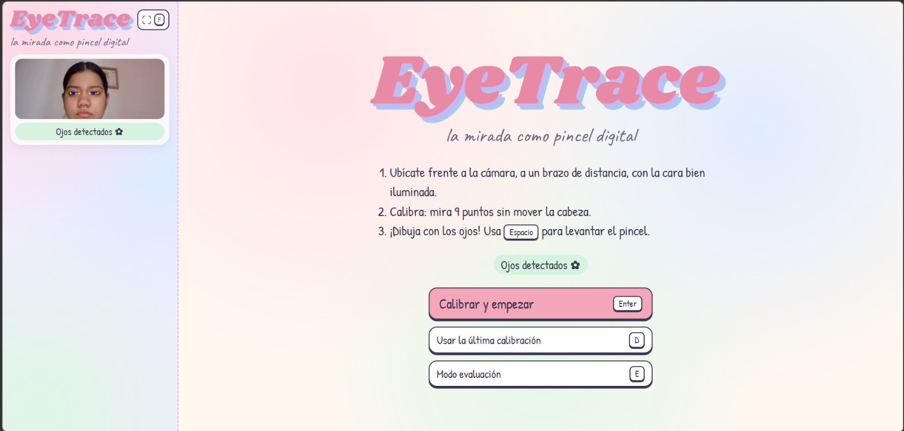 **Inicio:** estado de la detección y acceso a calibración y evaluación | 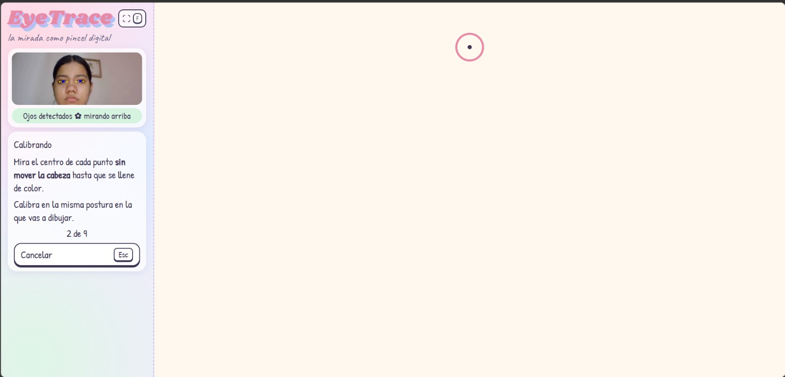 **Calibración:** 9 puntos que se llenan mientras se miran |
|  **Dibujo libre:** 8 colores pastel, modo arcoíris, grosor y 3 fondos | 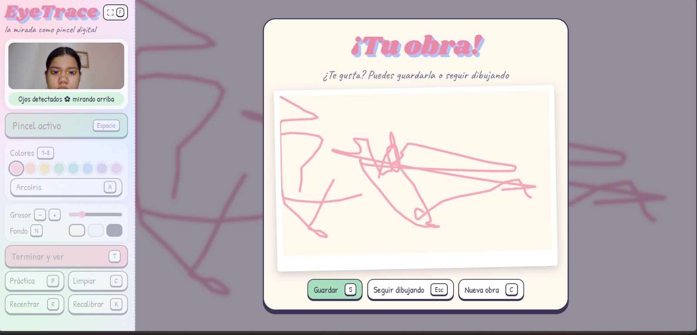 **Terminar (T):** vista previa para decidir si se guarda la obra |
| 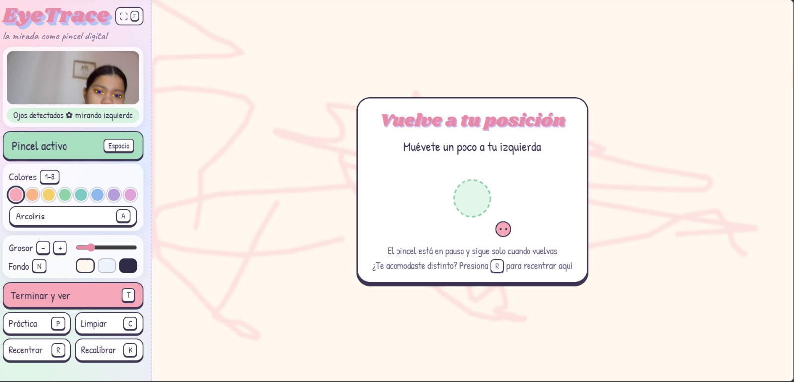 **Aviso de posición:** el pincel se pausa si la cabeza se mueve | 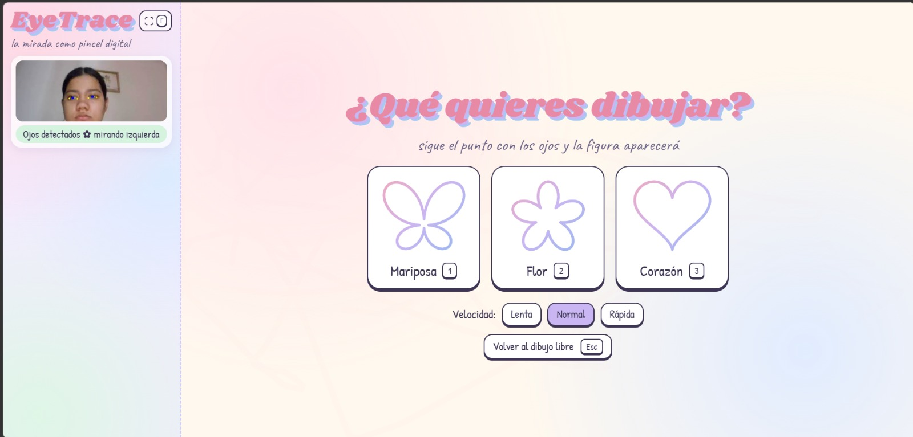 **Práctica:** elegir figura y velocidad |
| 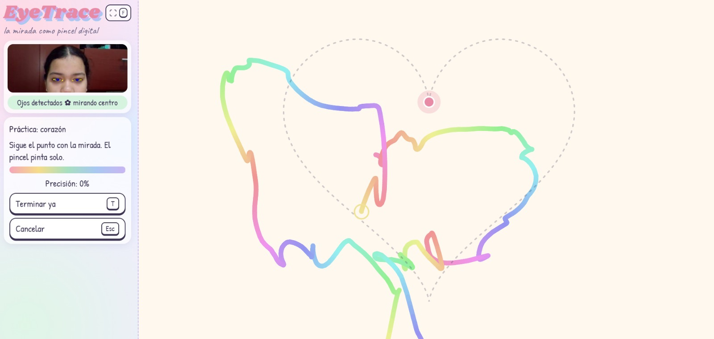 **Práctica:** seguir el punto por la silueta punteada | 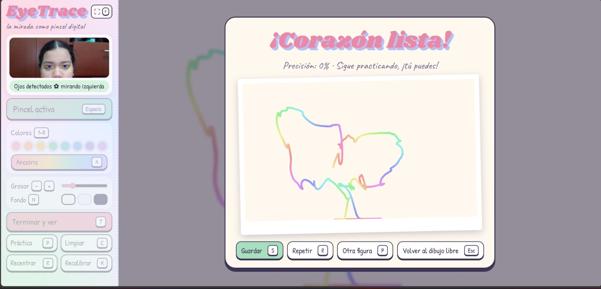 **Resultado:** la figura y la precisión de seguimiento |

Capturas tomadas con la cámara real durante las pruebas. En la barra lateral se ve el video procesado con los landmarks del iris dibujados por OpenCV.

### Controles principales

| Tecla | Acción | Tecla | Acción |
|---|---|---|---|
| Espacio | Pausar o activar el pincel | T | Terminar y ver la obra |
| 1 – 8 | Elegir color | P | Modo práctica |
| A | Modo arcoíris | R | Recentrar |
| + / − | Grosor del pincel | K | Recalibrar |
| N | Cambiar fondo | F | Pantalla completa |
| C | Limpiar | E | Modo evaluación (en el inicio) |

Instrucciones completas, consejos de calibración y solución de problemas: **[docs/manual_de_uso.md](docs/manual_de_uso.md)**.

### Evolución del prototipo

1. **Prototipo de escritorio** (`main_escritorio.py`): ventana de Pygame con rangos de mirada fijos, ajustados a una sola persona.
2. **Calibración por usuario:** 9 puntos y mínimos cuadrados, para que funcione con cualquier persona y cámara.
3. **Interfaz web:** barra lateral fija, tipografías, colores pastel y vista previa antes de guardar.
4. **Modo práctica:** figuras guiadas para aprender a controlar el pincel con los ojos.
5. **Aviso de posición y recentrado:** respuesta a la principal causa de pérdida de calibración observada en las pruebas internas, que era mover la cabeza para mirar el teclado.
6. **Modo evaluación:** registro de datos y métricas para la validación con usuarios.

---

## 7. Resultados

### Participantes y condiciones

Se completó **1 sesión de evaluación registrada** (participante **P01**: sin lentes, iluminación regular, 277 s) con el modo evaluación: calibración, prueba de exactitud con 9 puntos nuevos, práctica de las tres figuras, un minuto de dibujo libre y encuesta. Además, el equipo hizo **pruebas informales con otras personas** que no se registraron en `datos/`. Sus observaciones se incluyen solo de forma cualitativa.

> Con un solo participante registrado, las cifras describen el desempeño en ese caso y **no permiten generalizar** ni comparar condiciones (lentes, iluminación). Las desviaciones estándar que aparecen son entre puntos o fotogramas de la misma sesión, no entre personas.

### Resumen

| Métrica | Resultado P01 |
|---|---|
| Detección de ambos ojos | **94,9 %** de los fotogramas |
| Fotogramas por segundo | **30 FPS** (límite de la cámara) |
| Procesamiento por fotograma | **9,4 ms** en promedio (mediana 9,1 ms; p95 10,9 ms; máximo 14,6 ms) |
| Error de exactitud | **76 px** (5,3 % de la diagonal del lienzo) |
| Dispersión de la mirada (RMS) | **57 px** |
| Precisión en la práctica | **11 %** en promedio (corazón 7 %, flor 6 %, mariposa 20 %) |

### Exactitud por punto de prueba

| Punto | Posición en el lienzo | Error (px) | Desfase x / y (px) |
|---|---|---|---|
| 1 | arriba izquierda (0,30; 0,25) | 45 | −22 / +39 |
| 2 | arriba derecha (0,70; 0,25) | 96 | −15 / +95 |
| 3 | arriba centro (0,50; 0,35) | 86 | −66 / +55 |
| 4 | centro izquierda (0,20; 0,55) | 24 | −1 / −24 |
| 5 | centro (0,50; 0,62) | 31 | −21 / −23 |
| 6 | centro derecha (0,80; 0,55) | 40 | −26 / +30 |
| 7 | abajo izquierda (0,35; 0,80) | 106 | −105 / +14 |
| 8 | abajo derecha (0,65; 0,80) | 97 | −96 / +17 |
| 9 | esquina inferior derecha (0,92; 0,88) | 159 | −157 / +22 |

| | |
|---|---|
| 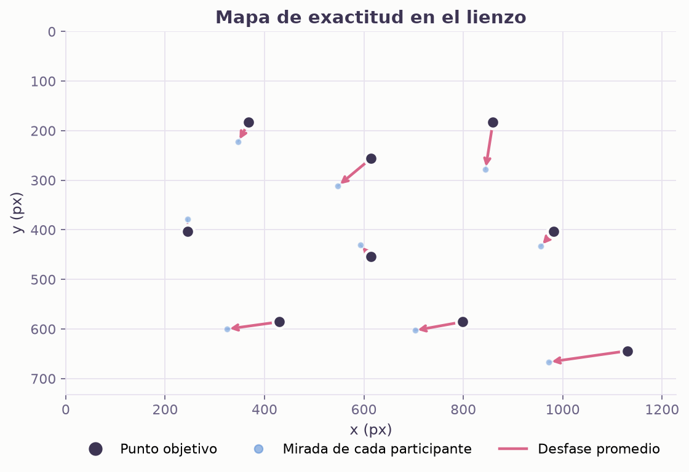 | 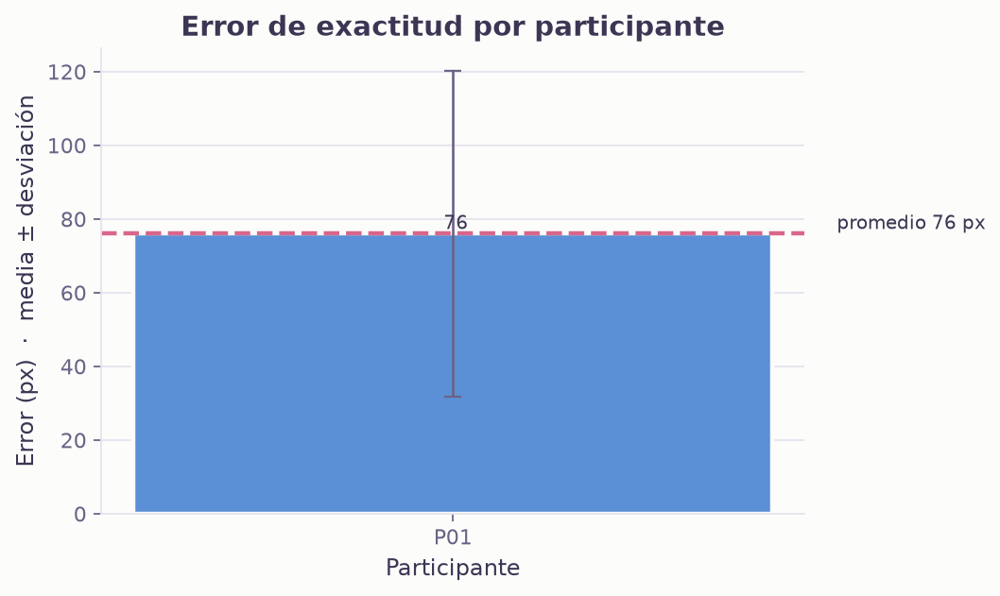 |

### Detección de los ojos por etapa

| Etapa | Duración | Detección de ambos ojos | Pérdidas de detección por minuto* |
|---|---|---|---|
| Calibración | 25 s | 95,3 % | 17 |
| Prueba de exactitud | 39 s | 88,4 % | **47** |
| Práctica | 94 s | 95,7 % | 19 |
| Dibujo libre | 65 s | 97,4 % | 17 |

\* Interrupciones de 2 o más fotogramas con el rostro visible pero sin ambos ojos válidos. Corresponden sobre todo a parpadeos: duran en promedio entre 90 y 170 ms.

### Práctica, rendimiento y encuesta

| | |
|---|---|
| 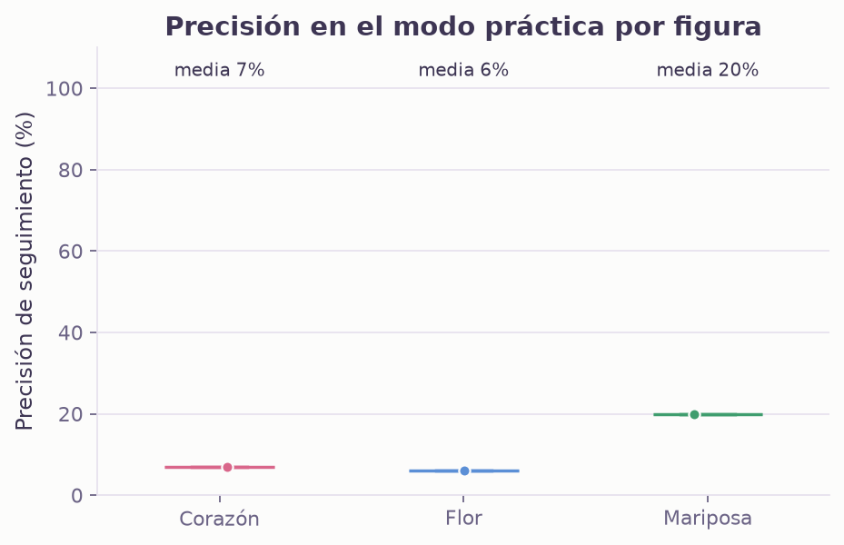 | 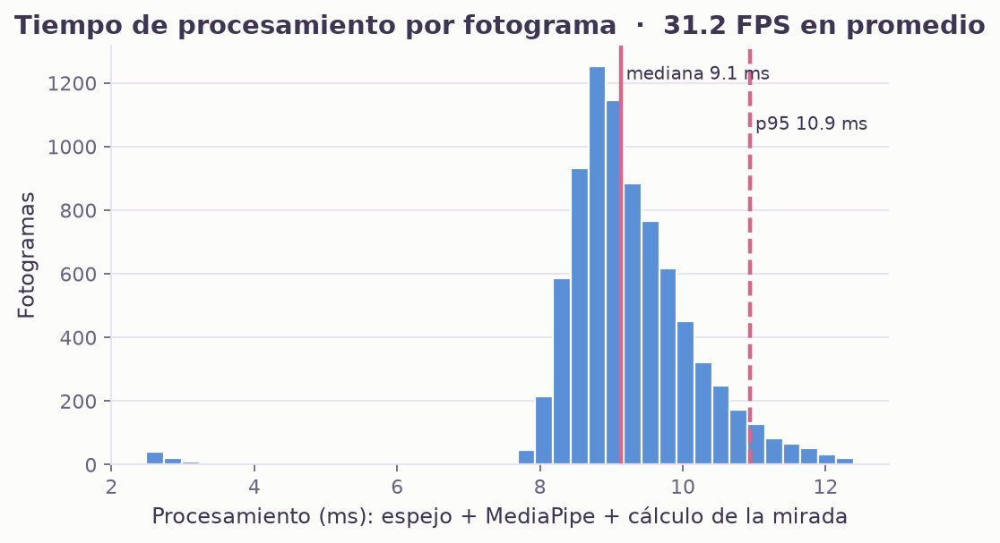 |

| Afirmación (escala 1 a 5) | P01 |
|---|---|
| Fue fácil controlar el pincel con la mirada | 3 |
| El pincel siguió mi mirada a donde yo quería | 3 |
| El sistema respondió rápido, sin retraso molesto | 5 |
| La calibración fue sencilla | 5 |
| Me sentí cómodo/a, sin cansancio en los ojos | 4 |
| Me gustó la obra que creé | 4 |
| Recomendaría esta experiencia a otras personas | 5 |

> Comentario: *"Es muy entretenido, lo único es que se me resecan mucho los ojos a la hora de usarlo."*

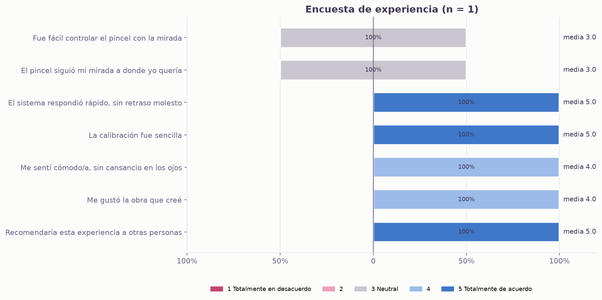

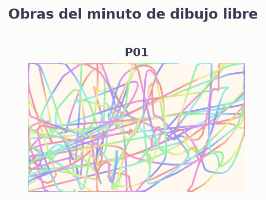

Tablas completas: [`resultados/resultados.md`](resultados/resultados.md).

### Análisis

**El sistema funciona en tiempo real.** Procesar cada fotograma (espejo, MediaPipe y cálculo de la mirada) toma 9,4 ms en promedio y nunca pasó de 14,6 ms, muy por debajo de los 33 ms que hay entre fotogramas a 30 FPS. El límite de velocidad lo pone la cámara, no el procesamiento. Esto coincide con la encuesta: la rapidez de respuesta recibió 5/5.

**La detección de los ojos es estable.** Se detectaron ambos ojos en el 94,9 % de los fotogramas y llegó al 97,4 % durante el dibujo libre. La mayoría de las pérdidas son parpadeos, que el filtro de apertura descarta a propósito para que no produzcan saltos del pincel.

**La exactitud depende de la zona del lienzo.** El error promedio fue de 76 px (5,3 % de la diagonal), pero no es uniforme:
- En la **franja central** el error fue bajo, con **32 px** de promedio en los puntos 4, 5 y 6.
- En la **franja inferior** fue **121 px** de promedio, con el máximo en la **esquina inferior derecha (159 px)**.
- El desfase tiene una **dirección sistemática**: en los 9 puntos el pincel quedó **a la izquierda** del objetivo (−57 px en promedio), y ese desplazamiento es mayor en la franja inferior, sobre todo en la esquina inferior derecha. Esto indica que la transformación afín, que es lineal, no captura del todo la relación entre el iris y la pantalla en los extremos, donde el ojo gira más y el párpado tapa parte del iris al mirar hacia abajo.
- La **dispersión** (57 px) es del mismo orden que el error, así que una parte importante del error se debe al temblor de la estimación y no solo al desfase.
- Durante la prueba de exactitud el aviso de posición no se muestra. En el registro de esa etapa, que incluye también la pantalla de resultados, el 36 % de los fotogramas muestra la cabeza fuera de la tolerancia de la calibración. Parte del error puede venir de movimientos de la cabeza durante la prueba.

**La práctica es la tarea más exigente.** La precisión de seguimiento fue baja (7 %, 6 % y 20 %). Esta métrica es estricta: compara el pincel con la posición **exacta y en movimiento** del punto guía, con una tolerancia de solo el 12 % del tamaño de la figura. Por eso castiga el retraso natural de la mirada al perseguir un objetivo y el desfase sistemático descrito arriba. Aun así, las figuras se reconocen: en las capturas el corazón conserva su forma, pero desplazado y más grande que la guía, que es el mismo patrón de desfase de la prueba de exactitud. La mariposa obtuvo la mejor precisión, posiblemente porque sus alas pasan varias veces por el centro del lienzo, la zona con menor error.

**Mantener la mirada fija cansa los ojos.** En la prueba de exactitud, donde hay que fijar la mirada en cada punto, las pérdidas de detección subieron a **47 por minuto**, casi el triple que en el dibujo libre (17 por minuto), y la detección bajó al 88,4 %. Coincide con lo que reportaron la participante (*"se me resecan mucho los ojos"*) y las personas de las pruebas informales: la calibración y la práctica resultaron lo más difícil porque obligan a mantener los ojos abiertos y fijos por más tiempo.

**La experiencia fue positiva.** La participante calificó con 5 la rapidez, la sencillez de la calibración y la recomendación a otras personas, y con 4 su obra y la comodidad. La facilidad de control y la exactitud percibida quedaron en 3 (neutral), lo que coincide con el error medido. En las pruebas informales, a la mayoría de las personas les gustó la experiencia.

---

## 8. Conclusiones

**Logros**

- Se cumplieron los objetivos específicos:
  - se analizaron y seleccionaron técnicas de detección ocular con cámara web (landmarks de MediaPipe, posición relativa del iris, filtrado de parpadeos y suavizado);
  - se diseñó una arquitectura que separa el procesamiento de imágenes de la interfaz;
  - se implementó un prototipo funcional que dibuja con la mirada en tiempo real;
  - se validó con un modo de evaluación que mide exactitud, detección, rendimiento y experiencia.
- EyeTrace logra que una persona **dibuje solo con la mirada** usando una cámara web común. Los trazos siguen la dirección de la mirada y producen obras abstractas que los usuarios disfrutaron.
- El procesamiento es **ampliamente de tiempo real** (9,4 ms por fotograma a 30 FPS) y la detección de los ojos es **estable** (95 %).
- La calibración por persona, con mínimos cuadrados, permite que el sistema funcione con distintos usuarios. El error es menor en la zona central del lienzo (~32 px).

**Limitaciones**

- **Se registró una sola sesión de evaluación**, así que los resultados no se pueden generalizar ni permiten comparar condiciones como lentes o iluminación.
- Una cámara web común no alcanza la exactitud de un eye tracker infrarrojo: el error crece hacia la parte inferior y las esquinas del lienzo (hasta 159 px).
- **Mantener la calibración** exige que la cabeza no se mueva. El aviso de posición ayuda, pero sigue siendo la principal fuente de error.
- La calibración y el modo práctica **cansan y resecan los ojos**, porque obligan a fijar la mirada por varios segundos seguidos.
- La métrica de precisión de la práctica es muy estricta y no refleja del todo que las figuras sí se reconocen.

**Trabajo futuro**

- Evaluar con **más participantes** (8–10) y variar a propósito lentes e iluminación.
- Usar un **modelo de calibración no lineal** (por ejemplo, polinomial de segundo grado) o más puntos en los bordes para reducir el error en las esquinas.
- **Compensar el movimiento de la cabeza** dentro del modelo de la mirada, no solo avisar.
- Hacer la calibración y la práctica **más cortas o con pausas** para reducir el cansancio visual, y medir la práctica respecto a la forma de la figura en lugar del punto exacto.
- Explorar **reglas artísticas** basadas en fijaciones, velocidad de la mirada o tamaño de la pupila.

---

## 9. Referencias

- Ablavatski, A., Vakunov, A., Grishchenko, I., Raveendran, K., & Zhdanovich, M. (2020). *Real-time pupil tracking from monocular video for digital puppetry*. arXiv. https://arxiv.org/abs/2006.11341
- Bradski, G. (2000). The OpenCV library. *Dr. Dobb's Journal of Software Tools, 25*(11), 120–125.
- Duchowski, A. T. (2017). *Eye tracking methodology: Theory and practice* (3.ª ed.). Springer. https://doi.org/10.1007/978-3-319-57883-5
- Gonzalez, R. C., & Woods, R. E. (2018). *Digital image processing* (4.ª ed.). Pearson.
- Google. (2026). *Face landmark detection guide*. MediaPipe Solutions. https://ai.google.dev/edge/mediapipe/solutions/vision/face_landmarker
- Hansen, D. W., & Ji, Q. (2010). In the eye of the beholder: A survey of models for eyes and gaze. *IEEE Transactions on Pattern Analysis and Machine Intelligence, 32*(3), 478–500. https://doi.org/10.1109/TPAMI.2009.30
- Hornof, A. J., & Cavender, A. (2005). EyeDraw: Enabling children with severe motor impairments to draw with their eyes. *Proceedings of CHI '05*, 161–170. https://doi.org/10.1145/1054972.1054995
- Jacob, R. J. K. (1990). What you look at is what you get: Eye movement-based interaction techniques. *Proceedings of CHI '90*, 11–18. https://doi.org/10.1145/97243.97246
- Kartynnik, Y., Ablavatski, A., Grishchenko, I., & Grundmann, M. (2019). *Real-time facial surface geometry from monocular video on mobile GPUs*. arXiv. https://arxiv.org/abs/1907.06724
- Lugaresi, C., et al. (2019). *MediaPipe: A framework for building perception pipelines*. arXiv. https://arxiv.org/abs/1906.08172
- NumPy Developers. (2026). *NumPy documentation*. https://numpy.org/doc/
- Papoutsaki, A., Sangkloy, P., Laskey, J., Daskalova, N., Huang, J., & Hays, J. (2016). WebGazer: Scalable webcam eye tracking using user interactions. *Proceedings of IJCAI 2016*, 3839–3845.
- Soukupová, T., & Čech, J. (2016). Real-time eye blink detection using facial landmarks. *21st Computer Vision Winter Workshop*.
- Szeliski, R. (2022). *Computer vision: Algorithms and applications* (2.ª ed.). Springer. https://doi.org/10.1007/978-3-030-34372-9
- Zhang, X., Sugano, Y., Fritz, M., & Bulling, A. (2015). Appearance-based gaze estimation in the wild. *Proceedings of CVPR 2015*, 4511–4520. https://doi.org/10.1109/CVPR.2015.7299081

**Recursos de terceros:** modelo `face_landmarker.task` de Google MediaPipe (Apache 2.0). Fuentes Shrikhand, Patrick Hand y Caveat (SIL Open Font License, ver [`web/fuentes/`](web/fuentes/)).
