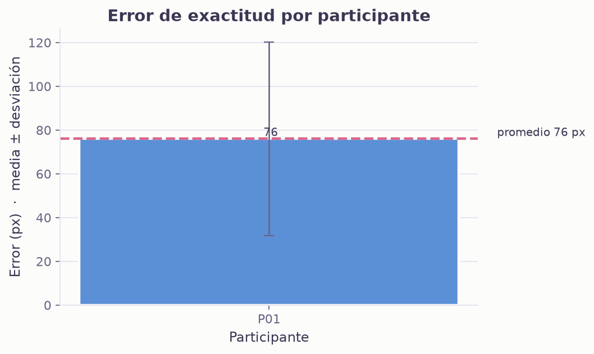
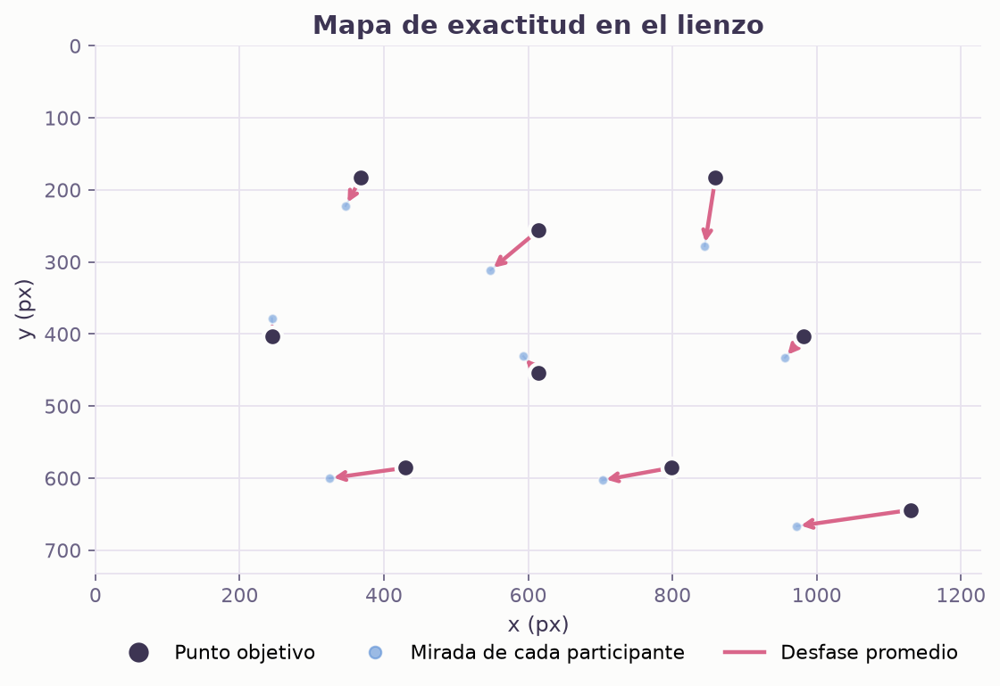
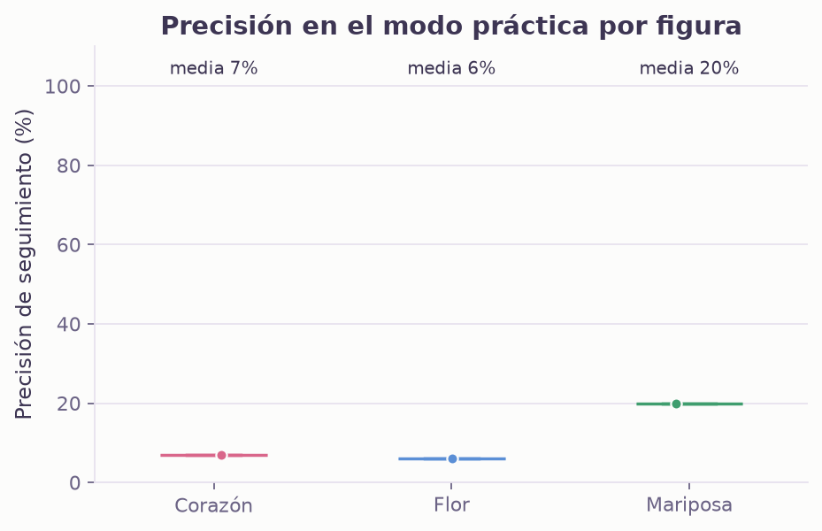
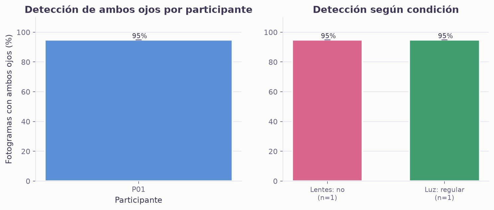
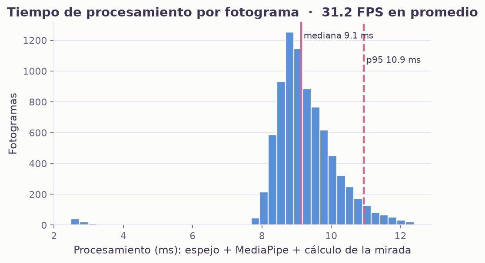
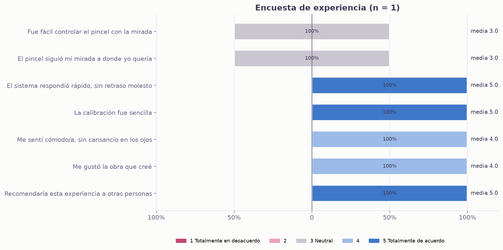
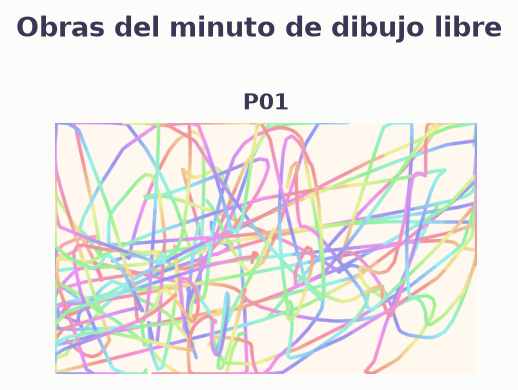

# Resultados de la evaluación de EyeTrace

Participantes: **1**  
Puntos de exactitud medidos: **9**  
Figuras practicadas: **3**  
Encuestas: **1**

## Resumen general (media ± desviación estándar entre participantes)

| Métrica | Media ± DE | Rango |
|---|---|---|
| Detección de ambos ojos | 94.9 ± 0.0% | 94.9 – 94.9% |
| Fotogramas por segundo | 30.0 ± 0.0 | 30.0 – 30.0 |
| Procesamiento por fotograma | 9.4 ± 0.0 ms | 9.4 – 9.4 ms |
| Error de exactitud | 76 ± 0 px | 76 – 76 px |
| Error de exactitud (% diagonal) | 5.3 ± 0.0% | 5.3 – 5.3% |
| Dispersión de la mirada (RMS) | 57 ± 0 px | 57 – 57 px |
| Precisión en la práctica | 11.0 ± 0.0% | 11.0 – 11.0% |

## Por participante

| Participante | Lentes | Luz | Detección | FPS | Error (px) | Error (%) | Dispersión (px) | Práctica |
|---|---|---|---|---|---|---|---|---|
| P01 | no | regular | 94.9% | 30.0 | 76 | 5.3% | 57 | 11.0% |

## Exactitud según condición

| Condición | n participantes | Error medio (px) | Error medio (%) |
|---|---|---|---|
| Lentes: no | 1 | 76 ± 44 | 5.3 ± 3.1% |
| Iluminación: regular | 1 | 76 ± 44 | 5.3 ± 3.1% |

## Error por punto de prueba

| Punto | Objetivo (fracción del lienzo) | Error medio (px) | Desfase medio x / y (px) |
|---|---|---|---|
| 1 | (0.30, 0.25) | 45 ± 0 | -22 / +39 |
| 2 | (0.70, 0.25) | 96 ± 0 | -15 / +95 |
| 3 | (0.50, 0.35) | 86 ± 0 | -66 / +55 |
| 4 | (0.20, 0.55) | 24 ± 0 | -1 / -24 |
| 5 | (0.50, 0.62) | 31 ± 0 | -21 / -23 |
| 6 | (0.80, 0.55) | 40 ± 0 | -26 / +30 |
| 7 | (0.35, 0.80) | 106 ± 0 | -105 / +14 |
| 8 | (0.65, 0.80) | 97 ± 0 | -96 / +17 |
| 9 | (0.92, 0.88) | 159 ± 0 | -157 / +22 |

## Modo práctica por figura

| Figura | n | Precisión (%) | Duración (s) |
|---|---|---|---|
| Corazón | 1 | 7.0 ± 0.0 | 23.2 ± 0.0 |
| Flor | 1 | 6.0 ± 0.0 | 29.1 ± 0.0 |
| Mariposa | 1 | 20.0 ± 0.0 | 32.7 ± 0.0 |

## Detección de ambos ojos por etapa

| Etapa | Detección media |
|---|---|
| Calibración | 95.3 ± 0.0% |
| Prueba de exactitud | 88.4 ± 0.0% |
| Práctica | 95.7 ± 0.0% |
| Dibujo libre | 97.4 ± 0.0% |

## Encuesta (escala 1 a 5)

| Afirmación | Media ± DE | % de acuerdo (4–5) |
|---|---|---|
| Fue fácil controlar el pincel con la mirada | 3.00 ± 0.00 | 0% |
| El pincel siguió mi mirada a donde yo quería | 3.00 ± 0.00 | 0% |
| El sistema respondió rápido, sin retraso molesto | 5.00 ± 0.00 | 100% |
| La calibración fue sencilla | 5.00 ± 0.00 | 100% |
| Me sentí cómodo/a, sin cansancio en los ojos | 4.00 ± 0.00 | 100% |
| Me gustó la obra que creé | 4.00 ± 0.00 | 100% |
| Recomendaría esta experiencia a otras personas | 5.00 ± 0.00 | 100% |

### Comentarios

- Es muy entretenido, lo unico es que se me resecan mucho los ojos a la hora de usarlo

## Gráficas

